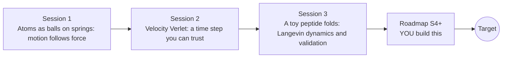

# openproteinmd

[](https://github.com/KrunalPanchal1995/openproteinmd/actions/workflows/ci.yml)   [](https://colab.research.google.com/github/KrunalPanchal1995/openproteinmd/blob/main/sessions/session-01/lesson.ipynb) [](https://krunalpanchal1995.github.io/openproteinmd/)

**Fold a toy peptide on your own computer, in three sessions.**

openproteinmd teaches molecular dynamics from scratch: forces, a trustworthy time-stepping rule, and a thermostat that lets a chain of beads collapse into a fold, using only Python and a browser.

- **Start from two atoms.** Session 1 needs only school algebra: a spring, a Lennard-Jones curve and the idea that motion follows force.
- **Trust your simulation.** Session 2 measures energy conservation and the time-step limit against an exact answer.
- **Watch a chain fold.** Session 3 cools a 12-bead toy peptide with a thermostat and finds the temperature where it folds.
- **Build the missing half.** The repo stops at Session 3 on purpose; the roadmap shows the path to the 3D Target.

[Target](#the-target) · [Who is this for](#who-is-this-for) · [Quick start](#quick-start) · [Sessions](#sessions) · [Roadmap](#roadmap) · [Contribute](#contribute) · [Explainer PDF](docs/explainer.pdf)

> **This repo is incomplete on purpose.** Sessions 1 to 3 are here and fully working. The finished Target below is a preview of what the community can build next. We show you the path, not the code. Sessions 4 and up are yours.

## The Target

A chain of 20 beads in three dimensions, red for hydrophobic and blue for polar, starts as a loose random coil and is cooled slowly with a Langevin thermostat. Its radius of gyration falls from about 3.4 sigma to about 1.45 sigma and its potential energy from about +4 to about -12 epsilon as the red beads gather in a compact core. In ten extra runs with different random seeds, all ended with a radius of gyration between 1.41 and 1.46 sigma. This is a toy model in reduced units, not a real protein. Your goal over the coming sessions: build the 3D, stiff-backbone version yourself.


*Target: a 20-bead 3D toy chain is cooled and collapses (radius of gyration and energy traces on the right)*


*Target, last frame: the chain after cooling to T = 0.2 (toy model, not a real protein)*


*Math Visual Studio: the Molecules workspace*

Try it live:

- [Math Visual Studio: molecular dynamics (Atlas S111)](https://krunalpanchal1995.github.io/studio/#atlas?ch=S111&ex=1)
- [Math Visual Studio: collision theory and reaction dynamics (Atlas S112)](https://krunalpanchal1995.github.io/studio/#atlas?ch=S112&ex=1)

How the Target was made is shown only as a path in [promo/roadmap.md](promo/roadmap.md).

## Who is this for
**secondary school to diploma / undergraduate (levels 3-5).** Topic area: Biology, Human Body and Health Science.

Prerequisites:

- Basic algebra and the idea of a force (mass times acceleration); school physics is enough.
- Python 3.10 or newer; if `python --version` works, you are ready. PRIMER.md explains the rest.
- No prior GitHub, chemistry or biology knowledge is needed.

New to Python? Read [PRIMER.md](PRIMER.md) first (10 minutes).

## Quick start

No installation knowledge needed. You need [Git](https://git-scm.com/downloads) and [Python 3.10+](https://www.python.org/downloads/) (Windows: tick "Add Python to PATH"). On Mac and Linux type `python3` wherever this page says `python`.

```bash
git clone https://github.com/KrunalPanchal1995/openproteinmd.git
cd openproteinmd
python start.py 1
```

`start.py` creates a private environment, installs what is needed and runs Session 1 with its checkpoint. Next: `python start.py 2`, `python start.py 3`, or `python start.py test` to check everything. Only a checkpoint: `python start.py check 1`.

Four lines turn the idea of Session 1 into a result (they work as they are): Save it as `try.py` and run it with `python start.py run try.py` (this uses the private environment, where NumPy is installed):

```python
import numpy as np
r = 2 ** (1 / 6)                                  # distance where two LJ atoms feel no force
V = lambda r: 4 * ((1 / r) ** 12 - (1 / r) ** 6)  # Lennard-Jones energy in reduced units
print(round(V(r), 3), round(V(1.5), 3))           # -> -1.0 -0.32  (the well, and a bit further out)
```

Every session also opens in your browser with sliders (no install): [live apps](https://krunalpanchal1995.github.io/openproteinmd/). Or use the Colab badge above for the notebook.

## Sessions

| # | Session | Model level | Time | Live app |
|---|---|---|---|---|
| 1 | [Atoms as balls on springs: motion follows force](sessions/session-01/README.md) | Level 1: conceptual interactive model | 60 min | [open](https://krunalpanchal1995.github.io/openproteinmd/session-01/) |
| 2 | [Velocity Verlet: a time step you can trust](sessions/session-02/README.md) | Level 2: mathematical engineering model | 75 min | [open](https://krunalpanchal1995.github.io/openproteinmd/session-02/) |
| 3 | [A toy peptide folds: Langevin dynamics and validation](sessions/session-03/README.md) | Level 3: simulation and validation | 90 min | [open](https://krunalpanchal1995.github.io/openproteinmd/session-03/) |

Each session follows the same six steps: A real-world problem, B concept and theory, C visual explanation, D interactive simulation, E worked example and experiment, F assessment and design challenge. Each ends with `checkpoint.py`, which prints `PASS` or `FAIL` against reference numbers. Session 3 also contains the real-world mini-project: **At which temperature does the 12-bead chain fold?**.

## Architecture



| Folder or file | What is inside |
|---|---|
| `sessions/` | three sessions: README (A-F), `lesson.py`, notebook, live app, exercises, activity sheet, checkpoint |
| `promo/` | the Target: media, live links, and the roadmap (path only) |
| `docs/` | `explainer.tex` and the built `explainer.pdf` |
| `tests/` | runs every lesson and checkpoint headless |
| `start.py` | one command to set up and run anything |
| `QUALITY.md`, `RUBRIC.md` | the quality checklist and the scoring rubric |
| `.github/` | CI, PDF build, Pages deploy, issue and PR templates |

## Roadmap

| Milestone | What you will build | Difficulty |
|---|---|---|
| Session 4: A stiffer backbone | Add the bending energy k (1 - cos phi), with phi the angle between consecutive bond vectors, to the 12-bead chain with k = 1.0. | intermediate |
| Session 5: Go 3D with a longer sequence | A 3D chain of 20 beads, sequence PHPHHPPHPHHPPHPHHPHP, bending strength 0.5, cooled from T = 1.0 to 0.2 over 560 tau. | advanced |
| Session 6: Error bars you can trust | Extend the mini-project so that each temperature reports a mean Rg with a standard error. | intermediate |
| Session 7: Compare with the exact lattice model | Enumerate every self-avoiding walk of 12 beads on a square lattice for HPHPPHHPHPPH and count H-H contacts. | advanced |

Full detail with a checkpoint per milestone: [promo/roadmap.md](promo/roadmap.md).

## Contribute
New to GitHub? Read [CONTRIBUTING.md](CONTRIBUTING.md); it starts from zero. Pick an issue labelled `good first issue`. Translations into Hindi, Telugu, Tamil and Malayalam are welcome.

<details>
<summary>Development</summary>

```bash
python start.py test        # runs every lesson and checkpoint
```
Lessons use `# %%` cell markers so they open as notebooks in VS Code. See [QUALITY.md](QUALITY.md) for the standard every session meets.
</details>

## License
MIT. See [LICENSE](LICENSE). Media in `promo/media` is (c) Krunal Panchal, CC BY 4.0.

## Acknowledgments
Part of the [PAN IIT OSS](https://hellofoss.tech-iitb.org/projects) open-source teaching collection, modelled on the structure of [openspline](https://github.com/openspline/openspline). Built on ideas from the Math Visual Studio at https://krunalpanchal1995.github.io/studio/.
