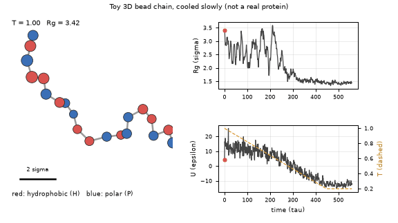
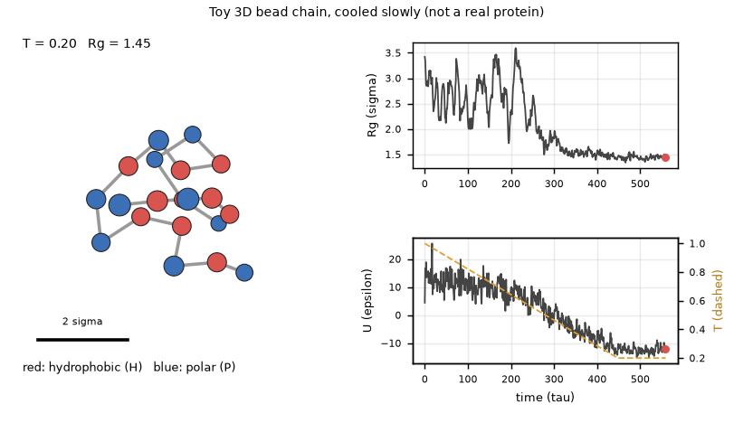
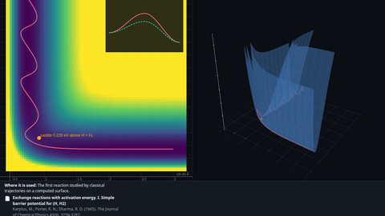

# What you are building toward

A chain of 20 beads in three dimensions, red for hydrophobic and blue for polar, starts as a loose random coil and is cooled slowly with a Langevin thermostat. Its radius of gyration falls from about 3.4 sigma to about 1.45 sigma and its potential energy from about +4 to about -12 epsilon as the red beads gather in a compact core. In ten extra runs with different random seeds, all ended with a radius of gyration between 1.41 and 1.46 sigma. This is a toy model in reduced units, not a real protein. Your goal over the coming sessions: build the 3D, stiff-backbone version yourself.

*Target: a 20-bead 3D toy chain is cooled and collapses (radius of gyration and energy traces on the right)*

*Target, last frame: the chain after cooling to T = 0.2 (toy model, not a real protein)*

*Math Visual Studio: the Molecules workspace*

These results come from a private reference build. The code is not published; the roadmap shows the path so you can build your own.

Live links:

- [Math Visual Studio: molecular dynamics (Atlas S111)](https://krunalpanchal1995.github.io/studio/#atlas?ch=S111&ex=1)
- [Math Visual Studio: collision theory and reaction dynamics (Atlas S112)](https://krunalpanchal1995.github.io/studio/#atlas?ch=S112&ex=1)
