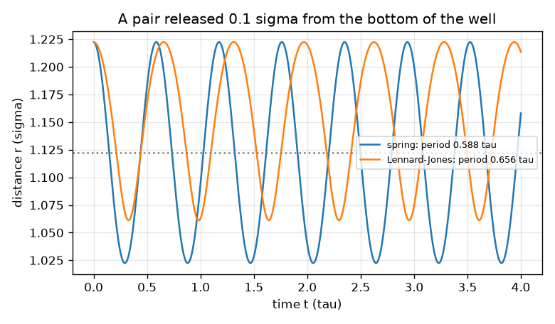
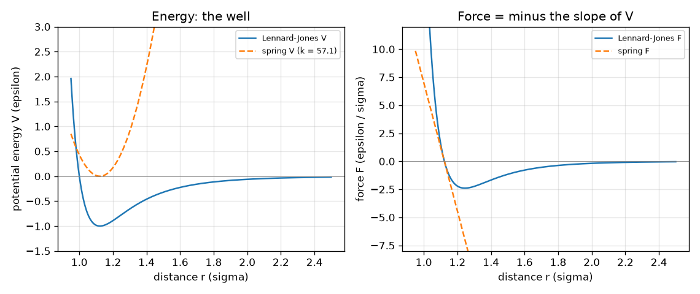

# Session 1: Atoms as balls on springs: motion follows force

*Level 1 (conceptual interactive model) · about 60 minutes · openproteinmd*

> This is a simplified educational model. It is not a validated design tool and must not be used for real structures, electrical installations, vehicles, industrial processes or medical decisions.

**Prerequisites**

- Algebra and the idea that force equals mass times acceleration.
- You have read PRIMER.md and run `python start.py 1` once.

**Learning objectives.** After this session you can:

- Explain that the force on an atom is minus the slope of its potential energy.
- Compute the energy and force of a spring and of a Lennard-Jones pair, by hand and in Python.
- Find the equilibrium bond length of a Lennard-Jones pair and say why it is 2^(1/6) sigma.
- Read a graph of potential energy and force against distance, and predict how a released pair moves.

## A. Real-world problem
A protein is a long chain of atoms, far too small to watch. Scientists therefore simulate it: they write down the force on every atom and let Newton's law move the atoms a tiny step at a time. Before a whole chain, take the smallest possible case, two atoms. What pulls them together, what pushes them apart, and where do they settle? Important honesty note: everything in this repo is a toy model in made-up reduced units. It teaches how molecular dynamics works; it is not a real protein and not a tool for any medical or drug decision. General education only.

## B. Concept and theory
We measure length in sigma, energy in epsilon and mass in m, so all three equal 1; time then comes out in tau = sigma sqrt(m / epsilon). Two atoms at distance r interact through a potential energy V(r). The force is minus the slope: F = -dV/dr, positive when it pushes the atoms apart and negative when it pulls them together. A chemical bond is pictured as a spring, V = (1/2) k (r - r0)^2, with force F = -k (r - r0). Two atoms that are not bonded interact through the Lennard-Jones law, V = 4 [(1/r)^12 - (1/r)^6]: a steep repulsion at short range (the atoms cannot overlap) and a weak attraction at longer range. Its bottom is at r = 2^(1/6) sigma = 1.1225 sigma with depth -1 epsilon, and near the bottom it looks like a spring of constant 36 * 2^(2/3) = 57.15. A ball released away from the bottom is accelerated by the force and oscillates. Two equal atoms behave like one ball of reduced mass mu = m/2, so a spring pair has period 2 pi sqrt(mu / k). Our update rule is the simplest one: v_new = v + (F / mu) dt, then r_new = r + v_new dt.

| Symbol | Meaning | Unit |
|---|---|---|
| r | distance between the two atoms | sigma |
| V | potential energy | epsilon |
| F | force along the line joining the atoms | epsilon / sigma |
| k | spring constant | epsilon / sigma^2 |
| r0 | spring rest length | sigma |
| mu | reduced mass of the pair (m/2) | m |
| dt | time step | tau |

**Assumptions**

- Reduced units: sigma = epsilon = m = 1.
- Two equal atoms, motion only along the line joining them (one coordinate r).
- No heat bath yet: the energy is not exchanged with anything.
- A toy model: not a real chemical bond and not a real protein.

$$ F(r)=-\frac{dV}{dr} $$

$$ V_{\mathrm{spring}}=\tfrac12 k\,(r-r_0)^2,\qquad F_{\mathrm{spring}}=-k\,(r-r_0) $$

$$ V_{\mathrm{LJ}}=4\left[\left(\frac1r\right)^{12}-\left(\frac1r\right)^{6}\right],\qquad F_{\mathrm{LJ}}=\frac{24}{r}\left[2\left(\frac1r\right)^{12}-\left(\frac1r\right)^{6}\right] $$

$$ r_{\min}=2^{1/6}\sigma,\qquad V(r_{\min})=-\varepsilon,\qquad V''(r_{\min})=36\cdot 2^{2/3}\,\varepsilon/\sigma^2\approx 57.15 $$

$$ T_{\mathrm{spring}}=2\pi\sqrt{\mu/k},\qquad \mu=m/2 $$

## C. Visual explanation
The first figure draws the two energy curves and the two force curves against the distance. The Lennard-Jones curve (blue) has a well with its bottom at 1.123 sigma and depth -1; the spring (dashed) was given k = 57.15 so that it has exactly the same shape at the bottom. They agree there but part ways further out: the spring keeps pulling harder and harder while the Lennard-Jones force fades away to nothing. The force curve crosses zero at the bottom of the well, where the energy has zero slope. The second figure shows a pair released 0.1 sigma from the bottom: both oscillate, the spring with period 0.588 tau, the Lennard-Jones pair a bit slower (0.656 tau) because its well is wider on the outside.

*A pair released 0.1 sigma from the bottom of the well: the spring period is 0.588 tau, the Lennard-Jones period is longer.*

*Energy (left) and force (right) of a Lennard-Jones pair and a matched spring: they agree at the bottom of the well and part ways further out.*

## D. Interactive simulation
Run the lesson (`python start.py 1`), then open the live app: [Session 1: a spring and a Lennard-Jones pair](https://krunalpanchal1995.github.io/openproteinmd/session-01/) (or `app.html` in this folder). Slide the distance r in the pair picture and watch the two force arrows flip direction at the bottom of the well. Change the spring constant and see how the red curve and the spring period change. Then switch to the energy and force graphs.

**Challenge.** Place the atoms at the Lennard-Jones bond length, where the force is zero (within 0.02 sigma).

## E. Worked example and experiment
**Problem.** Find the Lennard-Jones energy and force at r = 1.5 sigma. Is the pair pulled together or pushed apart?

1. Compute (1/r)^6 = (1/1.5)^6 = 0.08779 and (1/r)^12 = 0.00771.
2. V = 4 (0.00771 - 0.08779) = 4 (-0.08008) = -0.3203 epsilon.
3. F = (24 / 1.5) [2 (0.00771) - 0.08779] = 16 (-0.07237) = -1.158 epsilon / sigma.
4. The force is negative, so the atoms are pulled together: r = 1.5 is outside the bottom of the well (1.1225), and the force points back towards it.
5. Check with the energy slope: V at 1.49 and 1.51 differ by about 0.0232 over 0.02 sigma, a slope of +1.16, and F = minus that slope = -1.16. The two ways agree.

**Answer.** V = -0.3203 epsilon and F = -1.158 epsilon / sigma (attractive): the pair is pulled together.

**Experiment.** A real experiment on two atoms is impossible to do at home, but you can feel the idea: hold two small magnets so that they attract, and slowly push them close until they repel. There is a distance in between where they sit comfortably. Real atoms are similar but far more complicated; the measured depth and size of the Lennard-Jones well for a given gas (argon is the textbook case) are fitted values, so this model describes the cartoon, not real argon exactly. The Lennard-Jones law is a convenient approximation, not a law of nature.

## F. Assessment and design challenge
**Question type A: Conceptual.** A spring pair and a Lennard-Jones pair both oscillate about the same bottom. Why does the spring have a fixed period but the Lennard-Jones pair's period depends on how far you stretch it?

Hint

Compare the shape of the two energy curves away from the bottom.

Step-by-step solution

A spring has the same stiffness everywhere (a parabola), so its period 2 pi sqrt(mu/k) does not depend on the size of the swing. The Lennard-Jones well is not a parabola: it is steep on the inside and flattens out on the outside, so the farther you stretch the pair, the weaker the pull-back and the slower the motion. In the lesson a swing of 0.1 sigma gives a period of 0.656 tau and a swing of 0.5 sigma gives 1.609 tau. Only for very small swings does the Lennard-Jones pair behave like a spring.

**Question type B: Numerical.** A bond is modelled by a spring with k = 10 and r0 = 1. Find its energy and force at r = 1.3 (all in reduced units), and the Lennard-Jones energy and force at r = 2.

Hint

Use V = (1/2) k (r - r0)^2 and F = -k (r - r0); for Lennard-Jones compute (1/r)^6 first.

Step-by-step solution

Spring: V = 0.5 * 10 * 0.3^2 = 0.45 epsilon and F = -10 * 0.3 = -3.0 epsilon / sigma (pulls back). Lennard-Jones at r = 2: (1/2)^6 = 0.015625 and (1/2)^12 = 0.000244, so V = 4 (0.000244 - 0.015625) = -0.0615 epsilon and F = (24 / 2) (2 * 0.000244 - 0.015625) = 12 (-0.015137) = -0.1816 epsilon / sigma. Sanity check: at 2 sigma the attraction is already weak compared with the well depth of 1.

**Question type C: Graph and simulation interpretation.** On the energy graph, where is the force zero, and what happens to a pair released at r = 1.6 sigma? Read it from the slope.

Hint

Force is minus the slope of V.

Step-by-step solution

The slope of V is zero at the bottom of the well, r = 1.123 sigma, so the force is zero there. At r = 1.6 the curve slopes upwards (V rises with r), so the force is negative: the atoms are pulled together, speed up towards the bottom, overshoot it where the force reverses sign, and oscillate. Without any friction they never settle (Session 3 adds the heat bath).

**Question type D: Design and optimisation challenge.** Design: choose a spring constant so that a bond pair oscillates with a period of 0.5 tau, and say how large a time step you would then need to follow the motion with about 20 steps per period.

Hint

Solve T = 2 pi sqrt(mu / k) for k with mu = 0.5. Then divide the period by 20.

Step-by-step solution

k = mu (2 pi / T)^2 = 0.5 * (2 pi / 0.5)^2 = 0.5 * 157.9 = 79.0, check: 2 pi sqrt(0.5 / 79) = 0.4999 tau. With 20 steps per period dt = 0.5 / 20 = 0.025 tau. Trade-off: a stiffer bond is a faster oscillation, so it forces a smaller time step and a longer run for the same simulated time. This is why Session 2 studies the time step carefully.

Score yourself with [RUBRIC.md](../../RUBRIC.md). Print the [activity sheet](activity_sheet.md) to work on paper.

## Common misconceptions
| Common misconception | What is actually true |
|---|---|
| Atoms attract each other at all distances and just get closer and closer. | Lennard-Jones atoms attract only at intermediate range and repel strongly when squeezed; the force is zero at 1.1225 sigma, and that is the bond length. |
| Force and energy are the same thing. | Energy V is a height of the curve; force F is minus its slope. Zero force means zero slope, not zero energy: at the bottom the energy is -1. |
| A spring and a Lennard-Jones pair always oscillate with the same period. | They agree only for tiny swings near the bottom of the well; for bigger swings the Lennard-Jones period is longer. |
| The simulation shows what real atoms do. | It shows what the model does. The spring, the Lennard-Jones law and the reduced units are simple, fitted cartoons. |

## Glossary
- **potential energy**: stored energy that depends on where the atoms are; the force is minus its slope
- **Lennard-Jones potential**: a simple pair law that repels at short range and attracts weakly further out
- **reduced units**: units where sigma, epsilon and the atom mass all equal 1, so numbers are pure and the model is general
- **reduced mass**: the effective mass of two bodies moving towards or away from each other; m/2 for two equal atoms
- **anharmonic**: not a pure spring: the pull-back is not proportional to the stretch

## Finish
1. Do the three coding tasks in [exercises.md](exercises.md).
2. Run `python start.py 1` again after your changes. It ends with the checkpoint; when it prints `PASS`, you are done. (Checkpoint only: `python start.py check 1`.)

Next: [Session 2](../session-02/README.md)
