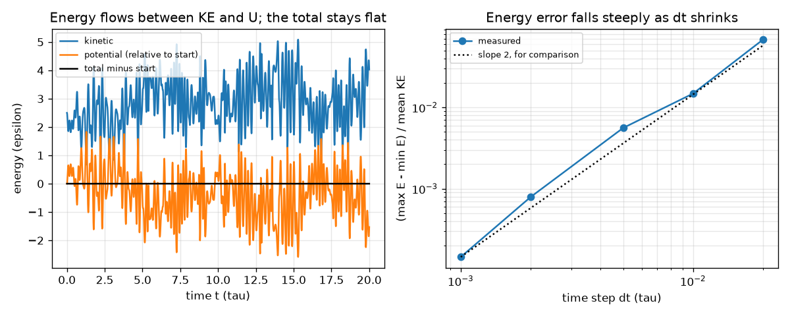
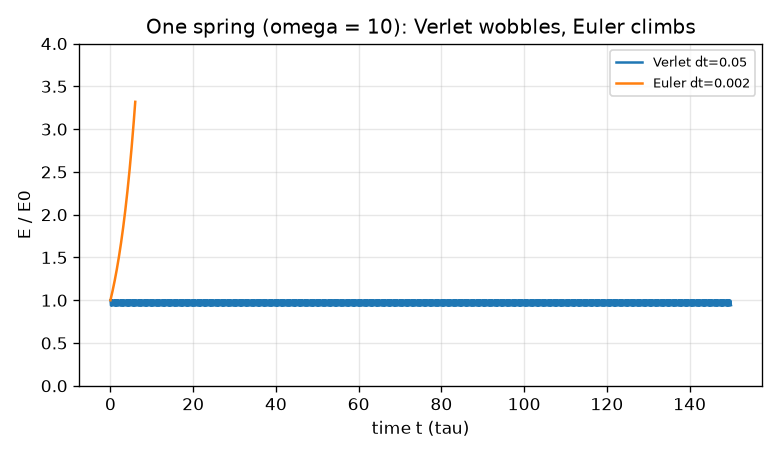

# Session 2: Velocity Verlet: a time step you can trust

*Level 2 (mathematical engineering model) · about 75 minutes · openproteinmd*

> This is a simplified educational model. It is not a validated design tool and must not be used for real structures, electrical installations, vehicles, industrial processes or medical decisions.

**Prerequisites**

- Session 1: forces from potentials and Lennard-Jones.
- Comfort with arrays in numpy is helpful; everything is explained as it appears.

**Learning objectives.** After this session you can:

- Write one velocity-Verlet step and explain its three parts (half kick, drift, half kick).
- Measure energy conservation and compare it with an exact answer.
- Compute the kinetic temperature of a chain from its velocities, counting degrees of freedom correctly.
- Choose a time step from the rule: energy error about (omega dt)^2 / 4 and stability only if omega dt < 2.

## A. Real-world problem
To follow atoms we must take small time steps. If the stepping rule is poor, the computer atoms gain energy out of nothing and the simulation blows up; if the steps are too small, a run takes forever. How accurate must the rule be, how big can the step be, and how do we know the simulation is behaving? We answer on a case with an exact solution (one ball on a spring) and then on a small chain of beads. Toy model in reduced units, general education only.

## B. Concept and theory
Newton's law says a = F / m. We cannot solve it exactly for many atoms, so we advance in steps of length dt. Velocity Verlet does this in three moves: kick the velocity by half a step with the current force, drift the positions a full step, recompute the force at the new positions and kick the velocity by the second half step. It is time-reversible and it nearly conserves energy: the energy wobbles a little but does not drift. For a ball on a spring with angular frequency omega = sqrt(k / m) the largest relative energy error is about (omega dt)^2 / 4, and the method is stable only if omega dt < 2. The naive explicit Euler rule is different: it multiplies the energy by exactly (1 + (omega dt)^2) at every step, so the energy climbs without limit. A chain of N beads in d = 2 dimensions has potential energy U = sum of bond springs (1/2) K (l - R)^2 plus Lennard-Jones between non-neighbours. Temperature in molecular dynamics is defined from kinetic energy: T = 2 KE / (number of degrees of freedom), in units of epsilon / k_B. When the total momentum is zero and conserved, d (N - 1) degrees of freedom count.

| Symbol | Meaning | Unit |
|---|---|---|
| omega | angular frequency sqrt(k/m) of the fastest motion | 1 / tau |
| dt | time step | tau |
| x, v, a | position, velocity, acceleration | sigma, sigma/tau, sigma/tau^2 |
| K | bond spring constant (100) | epsilon / sigma^2 |
| KE, U, E | kinetic, potential and total energy | epsilon |
| N, d | number of beads and of dimensions | no unit |
| T | kinetic temperature 2 KE / (d (N - 1)) | epsilon / k_B |

**Assumptions**

- Reduced units: sigma = epsilon = m = k_B = 1.
- The chain is isolated (constant energy, called NVE) and its centre-of-mass momentum is zero.
- The chain lives in a plane (d = 2).
- A toy model: no solvent, no angles, not a real peptide.

$$ \mathbf v_{n+\frac12}=\mathbf v_n+\tfrac{\Delta t}{2}\,\mathbf a_n,\qquad \mathbf x_{n+1}=\mathbf x_n+\Delta t\,\mathbf v_{n+\frac12},\qquad \mathbf v_{n+1}=\mathbf v_{n+\frac12}+\tfrac{\Delta t}{2}\,\mathbf a_{n+1} $$

$$ \frac{\left|E-E_0\right|_{\max}}{E_0}\approx\frac{(\omega\,\Delta t)^2}{4},\qquad \text{stable only if }\ \omega\,\Delta t<2 $$

$$ E_{n}^{\mathrm{Euler}}=E_0\,\big(1+\omega^2\Delta t^2\big)^{n} $$

$$ U=\sum_{\mathrm{bonds}}\tfrac12 K\,(l-R)^2+\sum_{|i-j|\ge 2}4\left[\left(\frac1{r_{ij}}\right)^{12}-\left(\frac1{r_{ij}}\right)^{6}\right] $$

$$ T=\frac{2\,\mathrm{KE}}{d\,(N-1)} $$

## C. Visual explanation
The first figure shows the energy of a 6-bead chain over 20 tau at dt = 0.005: kinetic and potential energy trade places, but their sum (black) stays flat to within 0.04 percent. Its right panel plots the energy fluctuation against the time step on logarithmic axes: it falls steeply as dt shrinks (from 6.8e-2 at dt = 0.02 down to 1.5e-4 at dt = 0.001, relative to the mean kinetic energy). The second figure uses one spring with omega = 10: velocity Verlet with a large step dt = 0.05 only wobbles within about 6 percent, while explicit Euler with a tiny step dt = 0.002 still climbs steadily (3.3 times the starting energy after 3000 steps).

*A 6-bead chain at constant energy: energies trade places and the total stays flat (left); the energy error falls as the time step shrinks (right).*

*One spring with omega = 10: Verlet wobbles, explicit Euler climbs.*

## D. Interactive simulation
Run the lesson (`python start.py 2`), then open the live app: [Session 2: how big can the time step be?](https://krunalpanchal1995.github.io/openproteinmd/session-02/) (or `app.html` in this folder). Change the spring constant k and the time step dt. Watch the blue Verlet points leave the exact curve as omega dt grows, then find the step where the energy error crosses 1 percent and the step where the run explodes (omega dt = 2).

**Challenge.** Use a stiff bond (k at least 300) and a step of at least 0.01 tau while keeping the Verlet energy error below 1 percent.

## E. Worked example and experiment
**Problem.** A bond has omega = 10 per tau. What is the largest time step that keeps the Verlet energy error below 1 percent? What is the stability limit?

1. Rule: error is about (omega dt)^2 / 4. We need (omega dt)^2 / 4 < 0.01.
2. So (omega dt)^2 < 0.04 and omega dt < 0.2, which gives dt < 0.2 / 10 = 0.02 tau.
3. Stability needs omega dt < 2, so dt < 2 / 10 = 0.2 tau, ten times larger than the accuracy limit.
4. Check by running it: the largest energy error over 20 periods is 0.0090 at dt = 0.019, 0.0100 at dt = 0.020 and 0.0110 at dt = 0.021; at dt = 0.21 (omega dt = 2.1) the energy blows up past a million times its start.

**Answer.** dt must be below 0.02 tau for a 1 percent energy error; the method explodes beyond 0.2 tau.

**Experiment.** Hang a mass on a spring from a retort stand, time 20 swings with a phone stopwatch and compare the period 2 pi sqrt(m/k) with a measured spring constant (stretch with known weights). Then simulate the same ball with Verlet at several time steps. The simulation has no friction or air drag, so it keeps swinging forever; the real spring slowly loses energy and the measured period is slightly off because the spring itself has mass. The numerical error (energy wobble) and the real losses are different things: do not confuse them.

## F. Assessment and design challenge
**Question type A: Conceptual.** Why does a poor integrator such as explicit Euler make the energy climb, while Verlet only makes it wobble?

Hint

Think about what the update does to energy at each step, and about time reversibility.

Step-by-step solution

Explicit Euler multiplies the oscillator energy by exactly (1 + (omega dt)^2) each step, which is always greater than 1, so the energy grows exponentially, a systematic error that adds up. Velocity Verlet is time-reversible and symmetric: errors in one half step are undone by the other, and it exactly conserves a slightly modified energy, so the true energy only wobbles around its starting value without drifting. This is why molecular dynamics uses Verlet-type integrators.

**Question type B: Numerical.** A 6-bead chain in 2D has zero total momentum and a total kinetic energy of 3.0 epsilon. What is its kinetic temperature? How many degrees of freedom did you use?

Hint

T = 2 KE / (d (N - 1)).

Step-by-step solution

Degrees of freedom: d (N - 1) = 2 * 5 = 10 (one set of 2 is used up by the fixed centre of mass). T = 2 * 3.0 / 10 = 0.6 epsilon / k_B. Sanity check: a kinetic energy of 0.3 per degree of freedom is 0.5 T per degree, so T = 0.6 is consistent. Using N instead of N - 1 would give 0.5, an error of 20 percent for a chain this small.

**Question type C: Graph and simulation interpretation.** From the spring numbers (energy error 0.0025 at dt = 0.01 and 0.0625 at dt = 0.05, with omega = 10), what is the slope on a log-log plot and what does it tell you about halving the time step?

Hint

Take the ratio of the errors and of the steps.

Step-by-step solution

The error ratio is 0.0625 / 0.0025 = 25 for a step ratio of 5, so error is proportional to dt^2 (5^2 = 25): slope 2. Halving the time step cuts the error by a factor of 4, but doubles the cost of a run. On the chain data the same trend is steeper or shallower in places because the chain has many frequencies; the dotted slope-2 line is only for comparison.

**Question type D: Design and optimisation challenge.** Design: for a stiffer chain with K = 400 the fastest vibration has omega about 2 sqrt(K) = 40 per tau (an estimate from a harmonic chain). Choose the largest time step with energy error below 1 percent, and say what you give up.

Hint

Use omega dt < 0.2 and check that it is also below the stability limit 2 / omega.

Step-by-step solution

omega dt < 0.2 gives dt < 0.2 / 40 = 0.005 tau. The stability limit is 2 / 40 = 0.05 tau, so accuracy, not stability, sets the step. Compared with K = 100 (omega about 20, dt below 0.01) the cost of a run for the same simulated time doubles. The trade-off: stiffer bonds buy fidelity to a rigid bond length but cost computer time. Many real simulations freeze the fastest bonds to afford a larger step. This is an estimate: verify it with run_nve.

Score yourself with [RUBRIC.md](../../RUBRIC.md). Print the [activity sheet](activity_sheet.md) to work on paper.

## Common misconceptions
| Common misconception | What is actually true |
|---|---|
| A smaller time step always gives an exact answer. | It gives a smaller error, not zero error, and costs more computer time; rounding errors also add up over very long runs. |
| If the energy is conserved the simulation is correct. | Conserved energy only shows that the integrator is consistent with the forces you coded. Wrong forces conserve energy too. Check the forces against the gradient of U as well. |
| Temperature is conserved in a constant-energy run. | In NVE the total energy is fixed and kinetic energy trades with potential energy, so the instantaneous temperature fluctuates; it is the average that means something. |
| Verlet never fails. | If omega dt is 2 or more it explodes, however good the method is. |

## Glossary
- **velocity Verlet**: a time-stepping rule: half kick, drift, half kick; time-reversible and nearly energy conserving
- **NVE**: constant number of atoms, volume and energy: an isolated simulation with no heat bath
- **degrees of freedom**: the number of independent coordinates that can move; here d (N - 1) with the centre of mass fixed
- **kinetic temperature**: temperature defined from kinetic energy, 2 KE divided by the degrees of freedom
- **time-reversible**: running the steps backwards with reversed velocities returns to the start

## Finish
1. Do the three coding tasks in [exercises.md](exercises.md).
2. Run `python start.py 2` again after your changes. It ends with the checkpoint; when it prints `PASS`, you are done. (Checkpoint only: `python start.py check 2`.)

Next: [Session 3](../session-03/README.md)
