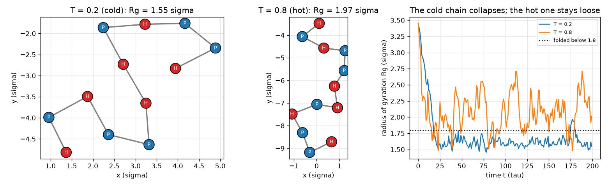
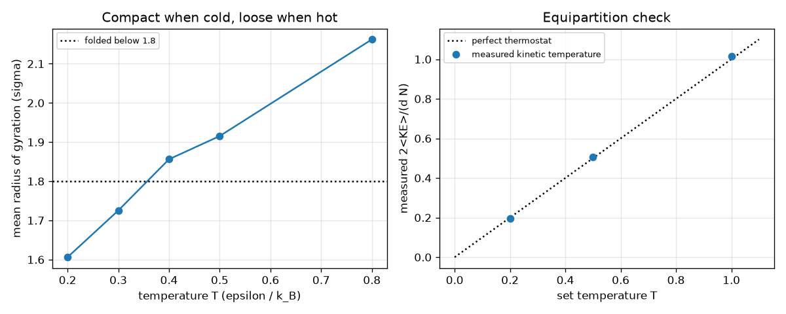

# Session 3: A toy peptide folds: Langevin dynamics and validation

*Level 3 (simulation and validation) · about 90 minutes · openproteinmd*

> This is a simplified educational model. It is not a validated design tool and must not be used for real structures, electrical installations, vehicles, industrial processes or medical decisions.

**Prerequisites**

- Session 1: forces and Lennard-Jones.
- Session 2: velocity Verlet, kinetic temperature and the time step.

**Learning objectives.** After this session you can:

- Build a coarse-grained hydrophobic/polar (HP) bead chain and explain what its H-H attraction stands for.
- Run constant-temperature (Langevin) dynamics and watch the radius of gyration fall as the chain collapses.
- Validate the simulation with energy conservation (NVE) and the equipartition temperature.
- Measure how the folded state depends on temperature and on the time step, including a case that fails.

## A. Real-world problem
In water, the greasy (hydrophobic) parts of a protein hide together in the middle while the water-loving (polar) parts stay outside; this crowding is one of the main reasons that a chain collapses into a compact shape. How cold must a toy chain be to stay folded? We build the simplest cartoon of the idea, the HP model, run a real molecular dynamics simulation with a thermostat, validate it, and ask at which temperature the 12-bead sequence HPHPPHHPHPPH stays folded. Honest limits: this is a 12-bead toy in 2D with made-up reduced units. Real peptides have 3D backbones, side chains, water and charges, and fold on timescales millions of times longer than anything here. Nothing in this repo predicts a real protein and nothing here is medical or drug-design advice. General education only.

## B. Concept and theory
Every bead has mass 1 and is joined to its neighbours by a stiff spring (K = 100, rest length 1). Two H beads that are not neighbours attract through full Lennard-Jones (well depth 1 epsilon); every other non-neighbour pair only repels (the Lennard-Jones curve cut at its minimum and shifted up by 1, so it is zero beyond 2^(1/6) sigma). The pull between H beads stands in for the hydrophobic effect; the water itself is not simulated. To hold the temperature we add a heat bath with the Langevin equation: friction (gamma = 1) plus random kicks. The BAOAB scheme applies a half kick (B), a half drift (A), the friction-and-noise step (O) with c1 = exp(-gamma dt) and c2 = sqrt(T (1 - c1^2)), another half drift (A) and a half kick (B). The kicks balance the friction so that every degree of freedom carries on average T/2 of kinetic energy (equipartition); a Langevin bath does not conserve total momentum, so all d N degrees of freedom count, and T_kin = 2 KE / (d N). The size of the chain is measured by the radius of gyration Rg, the root-mean-square distance of the beads from their centre. A straight chain of N beads with spacing 1 has Rg = sqrt((N^2 - 1) / 12). We call a chain folded when its mean Rg is below 1.8 sigma (a choice, not a law). The simulation is validated twice: the constant-energy run must conserve energy, and the thermostat must reproduce the set temperature.

| Symbol | Meaning | Unit |
|---|---|---|
| T | set temperature of the heat bath | epsilon / k_B |
| gamma | friction rate of the bath (1) | 1 / tau |
| Rg | radius of gyration of the chain | sigma |
| N | number of beads (12) | no unit |
| dt | time step (0.01) | tau |
| T_kin | measured kinetic temperature 2 KE / (d N) | epsilon / k_B |
| contacts | number of non-neighbour H-H pairs closer than 1.5 sigma | no unit |

**Assumptions**

- Reduced units: sigma = epsilon = m = k_B = 1.
- Two dimensions, 12 beads, no solvent, no bond-angle forces, no electric charges.
- H-H attraction is a stand-in for the hydrophobic effect.
- Time-averaged quantities ignore the first quarter of each run, while the chain relaxes.
- A toy model, not a real protein; general education only.

$$ U=\sum_{\mathrm{bonds}}\tfrac12 K\,(l-1)^2+\sum_{\substack{|i-j|\ge 2\\ \mathrm{both\ H}}}4\!\left[r^{-12}-r^{-6}\right]+\sum_{\substack{|i-j|\ge 2\\ \mathrm{otherwise}}}\left(4\!\left[r^{-12}-r^{-6}\right]+1\right)_{\,r<2^{1/6}} $$

$$ \mathbf v\leftarrow c_1\mathbf v+c_2\,\boldsymbol\xi,\qquad c_1=e^{-\gamma\Delta t},\quad c_2=\sqrt{T\left(1-c_1^2\right)},\quad \xi\sim\mathcal N(0,1) $$

$$ \langle \mathrm{KE}\rangle=\tfrac12\,d\,N\,T\quad\text{(equipartition)} $$

$$ R_g=\sqrt{\frac1N\sum_i\left|\mathbf r_i-\mathbf r_{\mathrm{cm}}\right|^2},\qquad R_g^{\mathrm{straight}}=\sqrt{\frac{N^2-1}{12}} $$

## C. Visual explanation
The first figure compares one cold run (T = 0.2) with one hot run (T = 0.8), both started from a straight chain with Rg = 3.45 sigma. The cold chain collapses within a few tens of tau to Rg of about 1.6 sigma with its red (hydrophobic) beads gathered in a cluster (mean 5.6 H-H contacts); the hot chain stays loose with Rg of about 2.1 sigma (mean 1.4 contacts). The right-hand panel shows both radius-of-gyration traces and the 1.8 line. The second figure holds the validation and the temperature scan. On the left the mean Rg rises smoothly with T, with no sharp jump: a crossover, not a phase transition. On the right the measured kinetic temperature sits on the line of the set temperature, within about 2 percent (0.197, 0.508 and 1.016 for set values 0.2, 0.5 and 1.0).

*A cold (T = 0.2) and a hot (T = 0.8) run of the 12-bead chain, and their radius of gyration against time.*

*Mean radius of gyration against temperature (left) and measured against set kinetic temperature (right).*

## D. Interactive simulation
Run the lesson (`python start.py 3`), then open the live app: [Session 3: fold the toy peptide](https://krunalpanchal1995.github.io/openproteinmd/session-03/) (or `app.html` in this folder). Slide the temperature and watch the chain, the trace and the lesson table. Then raise the time step towards its maximum and watch the readout until the run blows up.

**Challenge.** Fold the chain (T at most 0.3) with a time step of at most 0.02 tau, so that the energy error stays small.

## E. Worked example and experiment
**Problem.** (a) What is the radius of gyration of the straight 12-bead chain? (b) At T = 0.5, what mean kinetic energy should the thermostat produce for 12 beads in 2D, and what does the simulation give?

1. (a) Rg = sqrt((N^2 - 1) / 12) = sqrt(143 / 12) = sqrt(11.917) = 3.452 sigma. Code: radius_of_gyration(extended_chain(12)) gives 3.452.
2. (b) Degrees of freedom: d N = 2 * 12 = 24 (the bath does not conserve momentum, so none is subtracted).
3. Equipartition: mean KE = (1/2) * 24 * 0.5 = 6.0 epsilon.
4. Run it: 20000 steps at T = 0.5 give a kinetic temperature of 0.508, so a mean KE of about 6.1 epsilon, within 2 percent of the prediction.
5. Hand check of Rg on a simpler shape: four beads at the corners of a unit square are each 0.707 from the centre, so Rg = 0.707 = sqrt(1/2).

**Answer.** Rg of the straight chain is 3.452 sigma; at T = 0.5 the mean kinetic energy is 6.0 epsilon (simulation 6.1, T_kin = 0.508).

**Experiment.** Hands-on: make a 12-link chain from beads or paper clips, lay it straight and measure the distance of each bead from the centre to get Rg; then crumple it into a ball and measure again: the ratio is roughly what the simulation shows between a straight and a folded chain (3.45 to about 1.6). Real proteins differ in an important way: their folding is guided by many specific interactions, water and side chains, takes microseconds to seconds, and cannot be reproduced by a 12-bead chain. Model versus reality: the HP model captures only the idea that hiding hydrophobic beads makes a compact shape.

## Real-world application and mini-project: At which temperature does the 12-bead chain fold?
Use `mean_rg` and `RG_FOLDED` from Session 3. The sequence is HPHPPHHPHPPH. For each temperature on the grid 0.30, 0.35, 0.40, 0.45, 0.50 (epsilon / k_B) run 4 independent Langevin runs of 20000 steps with dt = 0.01 (seeds 1 to 4, `mean_rg` does this for you) and call the chain folded when its mean radius of gyration is below 1.8 sigma. Report the folding temperature T* as the largest grid temperature that is still folded, and also an interpolated crossing between the two grid points that bracket 1.8. Run the control chain PPPPPPPPPPPP (no hydrophobic beads) on the same grid. This is a toy model: T* is a number for this cartoon only, not a property of any real peptide, and it depends on the 1.8 threshold you chose.

**Deliverable:** A script that prints a table of mean Rg against temperature for the HP chain and for the control chain, reports T* and the interpolated crossing, and saves a plot of both curves with the 1.8 line and error bars (the spread of the four run means).

**Success looks like:** The table shows HP mean Rg of 1.67, 1.70, 1.87, 1.96 and 1.93 sigma at T = 0.30 to 0.50, so T* = 0.35 and the interpolated crossing is about 0.38. The control chain stays between 2.17 and 2.28 sigma on the whole grid, so it never folds. Your write-up states why a single run is not enough and why the answer is a crossover, not a sharp transition.

## F. Assessment and design challenge
**Question type A: Conceptual.** The control chain PPPPPPPPPPPP never folds, even when cold, but HPHPPHHPHPPH does. What does that tell you about what causes the collapse in this model? And why does a correct equipartition temperature validate the thermostat but not the force field?

Hint

Look at which pairs attract. Then think about what equipartition tests and what it cannot test.

Step-by-step solution

In this model only H-H pairs attract, so with no H beads there is nothing to gather: the all-P chain only has excluded volume and stays at Rg of about 2.2 sigma (2.17 to 2.28 on the grid of the mini-project). The collapse of the HP chain therefore comes from the H-H attraction. Equipartition checks the heat bath: the random kicks and friction are balanced so that the kinetic energy equals T/2 per degree of freedom. It says nothing about whether the potential energy is a good description of real molecules, so a thermostat can pass this test while the model is still a cartoon. The force code is validated separately (force equals minus the gradient of U, energy conserved in NVE).

**Question type B: Numerical.** A 12-bead chain in 2D is held at T = 0.6 by the Langevin bath. What mean kinetic energy do you expect? If a run reports a mean KE of 6.0, what is its kinetic temperature and what would you suspect?

Hint

Use mean KE = (1/2) d N T and T_kin = 2 KE / (d N) with d N = 24.

Step-by-step solution

Expected mean KE = 0.5 * 24 * 0.6 = 7.2 epsilon. For KE = 6.0, T_kin = 2 * 6.0 / 24 = 0.5, which is 17 percent below the set 0.6. Far outside the 1 to 2 percent seen in the lesson, this would suggest a bug (for example the wrong number of degrees of freedom, an incorrect noise amplitude, or a run that is too short or has not yet reached equilibrium).

**Question type C: Graph and simulation interpretation.** In the lesson table of mean Rg against T (1.70 at T = 0.35, 1.87 at T = 0.40), at what temperature does the curve cross the folded line 1.8? Is there a sharp transition?

Hint

Linear interpolation between the two grid points.

Step-by-step solution

T = 0.35 + 0.05 * (1.8 - 1.70) / (1.87 - 1.70) = 0.35 + 0.05 * 0.59 = 0.38. The curve rises smoothly from 1.6 at T = 0.2 to 2.2 at T = 0.8 with no jump, so this is a gradual crossover and the 'folding temperature' depends on the 1.8 threshold we picked. Small chains (12 beads) have no sharp phase transition.

**Question type D: Design and optimisation challenge.** Design: you want to simulate 100 tau of the chain at T = 0.3, at the lowest computer cost, with an energy spread (max minus min of E divided by mean KE) below 5 percent in a constant-energy check. Choose dt from the lesson measurements and count the steps.

Hint

The measured spreads over 20 tau are 5.0e-3 (dt 0.005), 1.9e-2 (0.01), 4.8e-2 (0.02), 0.18 (0.04) and 4.3 (0.08).

Step-by-step solution

dt = 0.02 is the largest tested step with a spread below 5 percent (4.8 percent), and dt = 0.04 (18 percent) is too big. The steps needed are 100 / 0.02 = 5000. Caveats: 4.8 percent is close to the limit, so dt = 0.01 (1.9 percent, 10000 steps) is the safer choice if the budget allows, and the spread was measured for the constant-energy run, not for the thermostatted one. Trade-off: halving dt doubles the cost; a dt of 0.15 makes the run blow up.

Score yourself with [RUBRIC.md](../../RUBRIC.md). Print the [activity sheet](activity_sheet.md) to work on paper.

## Common misconceptions
| Common misconception | What is actually true |
|---|---|
| The simulation shows how real proteins fold. | It shows a 12-bead cartoon in 2D with made-up units. Real folding involves water, side chains, 3D geometry and microsecond-to-second timescales. |
| One run is enough to find the folding temperature. | A single run is random and can get stuck in a half-folded shape; mean Rg values scatter by about 0.1 sigma between runs. Average several runs. |
| There is a single sharp folding temperature. | A 12-bead chain has a gradual crossover; the value of T* depends on how you define folded (here Rg below 1.8). |
| A conserved energy or correct temperature proves the model is right. | They prove the integrator and thermostat work. The model's physics is still a simplification that needs separate validation. |
| The colder the better for folding. | Very cold chains move slowly and can stay trapped in a partly folded shape (the mean Rg at T = 0.2 is a little higher than at T = 0.25 in the lesson data). |

## Glossary
- **Langevin thermostat**: friction plus random kicks that hold the average kinetic energy at a set temperature
- **BAOAB**: a kick-drift-bath-drift-kick scheme for Langevin dynamics that samples well
- **equipartition**: each degree of freedom carries on average T/2 of kinetic energy
- **radius of gyration**: root-mean-square distance of the beads from their centre: the size of the chain
- **HP model**: a cartoon where hydrophobic (H) beads attract each other and polar (P) beads do not
- **coarse-grained**: each bead stands for a group of atoms, to make the model cheap
- **crossover**: a gradual change with temperature, as opposed to a sharp phase transition

## Finish
1. Do the three coding tasks in [exercises.md](exercises.md).
2. Run `python start.py 3` again after your changes. It ends with the checkpoint; when it prints `PASS`, you are done. (Checkpoint only: `python start.py check 3`.)

Next: the [roadmap](../../promo/roadmap.md). Session 4 is yours to build.
